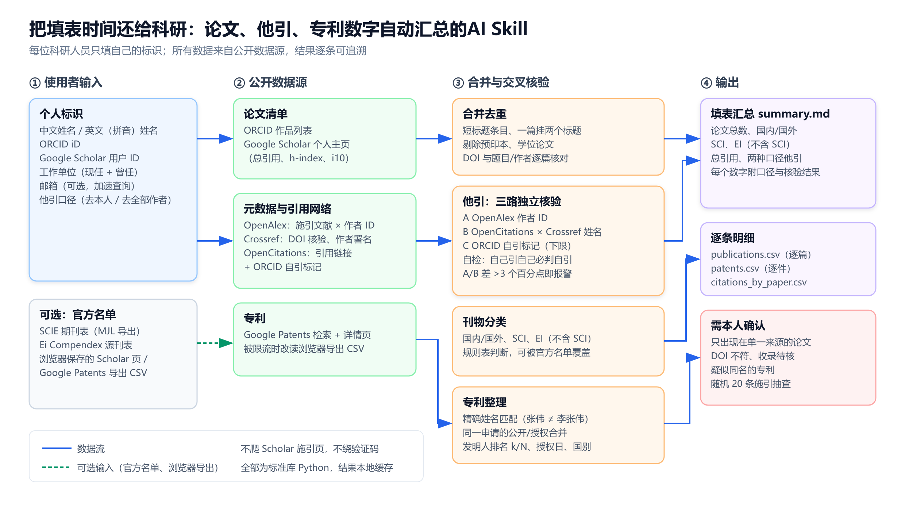
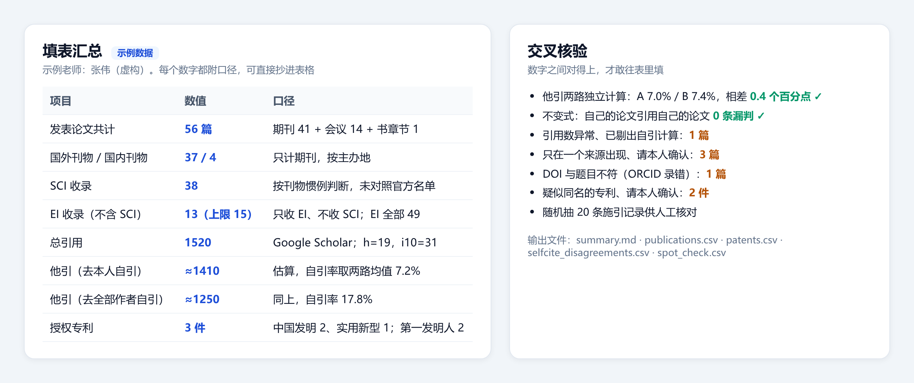

# paper-patent-stats

**把填表时间还给科研：论文、他引、专利数字自动汇总的 AI Skill。** 多源交叉核验，每个数字都说得清来源。

职称评审、人才计划、基金申请、结题和年度考核，几乎每张表都要问同样几个数：发表论文共计多少篇，国外、国内刊物各多少篇，SCI、EI 各收录多少篇，总引用和他引各多少次，授权专利有哪些。

Google Scholar 只给得出总引用。其余数字得从多个数据库拼出来，而每个数据库都有自己的坑：同名作者被合并、预印本混进清单、引用数被错误 DOI 抬高、专利检索把「李张伟」也算成「张伟」……

`paper-patent-stats` 是一个给 AI 编程助手（Claude Code、Codex 等）用的 skill。你输入自己的 ORCID、Google Scholar ID 和姓名，它自动汇总这些数字，并用几个**相互独立的数据源**交叉核验。核对不上的地方会列出来请你确认，不会悄悄替你拍板。



## 能得到什么



| 项目 | 怎么算 |
|---|---|
| 发表论文共计 | ORCID 与 Scholar 合并去重；剔除预印本、学位论文，合并同一篇的重复条目 |
| 国外 / 国内刊物 | 只计期刊，按主办地划分（国内主办的英文刊算国内） |
| SCI / EI 收录 | EI 默认按「只收 EI、不收 SCI」统计，也同时给出 EI 总数；提供官方名单时以名单为准 |
| 总引用 | Google Scholar 个人主页，附 h-index、i10-index |
| 他引 | 两种口径：只去掉本人自引；去掉该文任一作者的自引 |
| 授权专利 | 国别、专利类型、专利名称、公告号、申请日、授权日、发明人排名 k/N |

> [!IMPORTANT]
> 他引是估算值：先在开放数据库里算出自引所占比例，再按这个比例从 Scholar 总引用中扣除。SCI/EI 默认按刊物惯例判断。正式材料请以图书馆的**查收查引报告**为准，本工具的作用是帮你提前心里有数、发现数据里的错误。

## 为什么信得过：交叉核验

- **他引两路独立计算。** 一路用 OpenAlex 的作者 ID 判断自引，另一路用 OpenCitations 的引用链接加 Crossref 的作者署名判断。两路差距超过 3 个百分点就报警，并列出判断不一致的每一条施引记录。第三路用 ORCID 自引标记，只作为下限参考。
- **不变式自检。** 你自己的论文引用你自己的论文，必须被判为自引。只要有一条漏判，就说明作者身份识别出了错。
- **单篇引用数比对。** 每篇论文对照 Scholar、OpenAlex、Crossref、OpenCitations 四个来源的引用数，异常的那篇会被剔出自引计算。
- **逐篇 DOI 核验。** 用 Crossref 核对每个 DOI 的题目和作者，能查出 ORCID 里录错的 DOI。
- **专利精确匹配。** 发明人必须与你的全名完全一致；同一申请的「公开」和「授权」两条记录合并为一件；与你其余专利没有共同发明人的，标为疑似同名，请你确认。
- **人工抽查。** 随机抽 20 条施引记录，供你亲手核对。

## 准备工作

每位老师自己提供以下信息。skill 不内置任何个人数据。

| 信息 | 用途 | 是否必需 |
|---|---|---|
| 英文姓名（拼音，如 `Wei Zhang`） | 自引判断、英文专利检索 | 必需 |
| ORCID iD | 论文清单 | 必需 |
| Google Scholar 用户 ID（主页网址里 `user=` 后面那串） | 论文清单、总引用 | 必需 |
| 中文姓名 | 中国专利检索 | 查专利时需要 |
| 工作单位（现任和曾任，中英文名称） | 专利按单位检索，避免同名 | 查专利时需要 |
| 邮箱 | 进入 OpenAlex/Crossref 的优先队列，查询更快 | 可选 |

还需要 Python 3.9 或更新版本。只用标准库，不需要 `pip install`。

## 安装

把仓库放进 AI 助手的 skill 目录：

```bash
# Claude Code
git clone https://github.com/jiankang1991/paper-patent-stats.git ~/.claude/skills/paper-patent-stats

# Codex 等支持 Agent Skills 的工具
git clone https://github.com/jiankang1991/paper-patent-stats.git ~/.agents/skills/paper-patent-stats
```

## 使用

### 在 AI 助手里直接说

> 我要填职称申报表，帮我统计发表论文总数、SCI 和 EI 各多少篇、总引用和他引次数，再查一下我的授权专利。

助手会先向你要上面那几项信息，再运行统计，最后给出一张可以直接抄进表格的汇总表，附上每个数字的口径和需要你确认的事项。

### 也可以直接运行脚本

```bash
# 论文与引用
python3 -I scripts/pubstats.py \
  --orcid 0000-0000-0000-0000 --scholar-user XXXXXXXXXXXX \
  --name "Wei Zhang" --out ./my-stats --exclude-from-year 2026

# 授权专利
python3 -I scripts/patents.py \
  --inventor 张伟 --inventor "Wei Zhang" \
  --assignee 示例大学 --assignee "Example University" --out ./my-patents
```

首次运行需要 5 到 20 分钟。所有网络响应都缓存在输出目录里，再次运行只要几秒。

| 输出文件 | 内容 |
|---|---|
| `summary.md` | 填表汇总、口径、交叉核验结果 |
| `publications.csv` | 逐篇明细：类型、国内外、SCI/EI 判断、来源、DOI 核验 |
| `selfcite_disagreements.csv` | 两路自引判断不一致的施引记录 |
| `spot_check.csv` | 随机 20 条施引记录，供人工核对 |
| `patents.csv` / `patents_summary.md` | 逐件专利明细与汇总 |

### 可选参数

- `--sci-list`、`--ei-list`：传入 Clarivate Master Journal List 导出的 SCIE 刊表、Elsevier 的 Ei Compendex 源刊表，收录判断就改用官方名单。
- `--scholar-html`：Scholar 主页打不开时，在浏览器里保存主页（每页 100 条，一直翻到不足 100 条的那一页），用这个参数传入。
- `--gp-csv`：Google Patents 限流时，在浏览器里搜索，点「Download (CSV)」，用这个参数传入导出文件。
- `--exclude`：排除你确认不是自己的专利（同名同事的）。

> [!TIP]
> 期刊的国内外、SCI、EI 判断规则放在 [`references/venue_rules.csv`](references/venue_rules.csv) 里，按「刊名正则 → 国内/国外 → SCI → EI」逐行匹配，可以自己补充本领域的期刊。

## 数据来源与边界

- **数据源：** ORCID、Google Scholar 个人主页、OpenAlex、Crossref、OpenCitations、Google Patents。全部是公开数据。
- **不做的事：**
  - 不爬 Google Scholar 的施引列表（会触发验证码）。
  - 不绕过任何验证码或反爬机制。
  - 不伪装浏览器访问国家知识产权局公布公告网站。
- **中国专利的法律状态：** 以国家知识产权局「中国及多国专利审查信息查询」为准，Google Patents 给出的状态只是推定。
- **隐私：** 你的信息只用于向上述公开数据源发起查询，结果保存在本机输出目录里，不上传到其他任何地方。

## 测试

```bash
python3 -m pytest -q tests
```

测试全部使用虚构数据。

---

**English summary.** An Agent Skill (for Claude Code, Codex and similar tools) that compiles a researcher's paper and patent statistics for Chinese application forms: total papers, foreign vs. domestic journals, SCI and EI (EI excluding SCI) counts, total citations, citations excluding self-citations, and granted patents with grant date and inventor rank. Every number is cross-checked across independent open sources (ORCID, Google Scholar, OpenAlex, Crossref, OpenCitations, Google Patents), and anything that does not reconcile is reported for the user to confirm. Pure Python standard library; no personal data is bundled.
